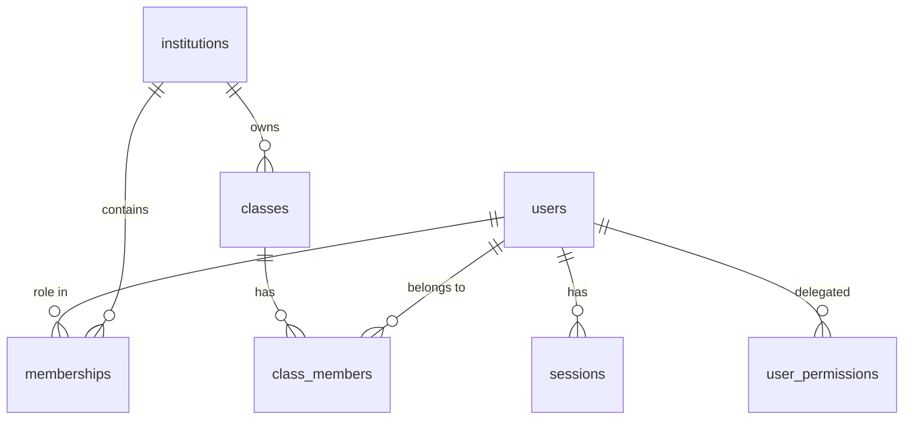

# Database schema

PostgreSQL 16. Source of truth: `apps/api/src/db/schema.ts`; migrations in `apps/api/drizzle/` (plain SQL).
Only the tables below exist. Exams, responses, results, notifications, files and reports are **not created yet**.



| Table | Purpose | Notable constraints |
|---|---|---|
| users | accounts | unique lowercase email (CHECK), status and platform_role CHECKs |
| sessions | server-side sessions | unique `token_hash` (SHA-256 only); expiry + revoked_at |
| user_permissions | delegated grants | PK (user, permission) |
| institutions | schools (tenants) | unique slug; status pending/active/suspended |
| memberships | a user's role in one institution — **the tenant boundary** | unique (user, institution, role); role/status CHECKs |
| classes | classes within an institution | unique (institution, name, academic year) |
| class_members | who is in a class | PK (class, user); role teacher/student |
| audit_logs | append-only event log | **trigger blocks UPDATE, DELETE, TRUNCATE** |
| subjects | per-school subjects | unique (institution, name, level) |
| topics | topics within a subject | unique (subject, name); carries institution_id |
| questions | the bank; type-specific answer data in `content` jsonb (validated by Zod before every write) | CHECKs on type/status/difficulty/source/marks; **CHECK: an AI question cannot be `approved` without a `reviewed_by`** |
| question_versions | snapshot of every version | PK (question, version) |
| ai_generations | one row per AI request (ok or failed): provider, model, prompt version, tokens, latency, counts, error | status CHECK; grounding text is NOT stored, only its length |
| platform_settings | key/value settings | created, not yet used by any feature |

## Quizzes and live sessions (migration 0003)

| Table | Purpose |
|---|---|
| `quizzes`, `quiz_items` | a teacher's quiz; each item pins a `question_version` |
| `quiz_sessions` | one run of a quiz: `join_code`, status (`lobby`/`active`/`ended`), `settings` jsonb snapshot, optional `class_id`, `ends_at`. Partial unique index `quiz_sessions_open_code_uq` on `join_code` where status ≠ `ended` |
| `session_questions` | frozen copy of each question (with its answer key) used by that session |
| `session_participants` | one per student per session; shuffled `question_order`, current index, `question_served_at` (server clock), running totals |
| `session_answers` | PK `(participant_id, idx)`: one row per answered question; makes retries idempotent |

## Exams (migration 0004)

| Table | Purpose |
|---|---|
| `exams`, `exam_sections`, `exam_items` | a reusable structure; items pin a `question_version`; CHECK refuses `official_verified` without `source_spec` |
| `exam_sittings` | a scheduled run for a school/class: window (`closes_at > opens_at` enforced), snapshot of title/duration/options, `results_released_at` |
| `sitting_sections`, `sitting_items` | frozen copies (content, key, marks) served to candidates |
| `exam_sessions` | one attempt per candidate (unique `(sitting_id, user_id)`); `deadline_at` set by the server; `marking_status` pending → marked |
| `exam_responses` | current answer per item with `seq` |
| `exam_response_versions` | every accepted change (insert-only by convention; **no DB trigger enforces this**) |
| `exam_submissions` | PK = session, so one submission per attempt; receipt (unique) and SHA-256 of final answers |
| `exam_marks` | per-item marks; only `auto` marks exist today |

## File uploads (migration 0005)
- `uploads` — id, institution_id, uploaded_by, filename (display only), kind (CHECK xlsx/docx/pptx/pdf/csv/txt/image), size_bytes, sha256, `sections` jsonb (extracted text), char_count, `question_table` jsonb (parsed rows or null), warnings jsonb, rights_confirmed_at, created_at. Unique `(institution_id, sha256)`. The original file is **not** stored.
- `questions.upload_id` (FK, set null on delete) records where imported or AI-grounded questions came from; `questions.source` now allows `'import'`.

## Audit immutability

`drizzle/0001_audit_immutable.sql` installs triggers that raise an error on UPDATE, DELETE and TRUNCATE of
`audit_logs`. Verified in tests and by hand on committed rows.

**Caveat:** the table owner can still drop the trigger. In development the app connects as the owner. For production,
run migrations as a separate owner role and give the app a role with only SELECT/INSERT on `audit_logs` — **not yet set up**.

## Migrations

```bash
pnpm db:generate   # after editing schema.ts
pnpm db:migrate    # apply (uses DATABASE_URL)
```

Never edit an applied migration; add a new one.

## Retention

No retention or deletion policy is implemented. One must be defined (student data, sessions, audit logs) before real use.
