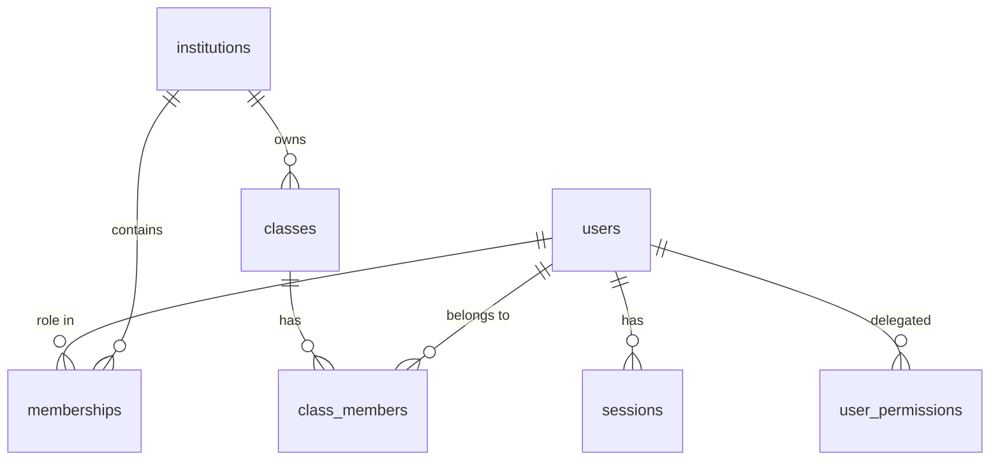

# Database schema

PostgreSQL 16. Source of truth: `apps/api/src/db/schema.ts`; migrations in `apps/api/drizzle/` (plain SQL).
Only the tables below exist. Question bank, exams, responses, results, AI jobs, notifications, files and reports
are **not created yet**.



| Table | Purpose | Notable constraints |
|---|---|---|
| users | accounts | unique lowercase email (CHECK), status and platform_role CHECKs |
| sessions | server-side sessions | unique `token_hash` (SHA-256 only); expiry + revoked_at |
| user_permissions | delegated grants | PK (user, permission) |
| institutions | schools (tenants) | unique slug; status pending/active/suspended |
| memberships | a user's role in one institution — **the tenant boundary** | unique (user, institution, role); role/status CHECKs |
| classes | classes within an institution | unique (institution, name, academic year) |
| class_members | who is in a class | PK (class, user); role teacher/student |
| audit_logs | append-only event log | **trigger blocks UPDATE, DELETE, TRUNCATE** |
| platform_settings | key/value settings | created, not yet used by any feature |

## Audit immutability

`drizzle/0001_audit_immutable.sql` installs triggers that raise an error on UPDATE, DELETE and TRUNCATE of
`audit_logs`. Verified in tests and by hand on committed rows.

**Caveat:** the table owner can still drop the trigger. In development the app connects as the owner. For production,
run migrations as a separate owner role and give the app a role with only SELECT/INSERT on `audit_logs` — **not yet set up**.

## Migrations

```bash
pnpm db:generate   # after editing schema.ts
pnpm db:migrate    # apply (uses DATABASE_URL)
```

Never edit an applied migration; add a new one.

## Retention

No retention or deletion policy is implemented. One must be defined (student data, sessions, audit logs) before real use.
